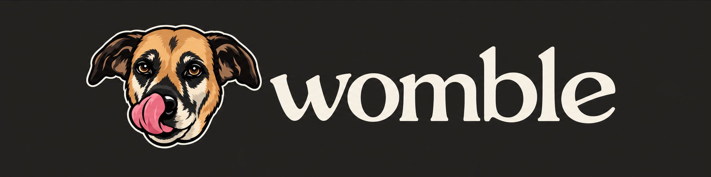
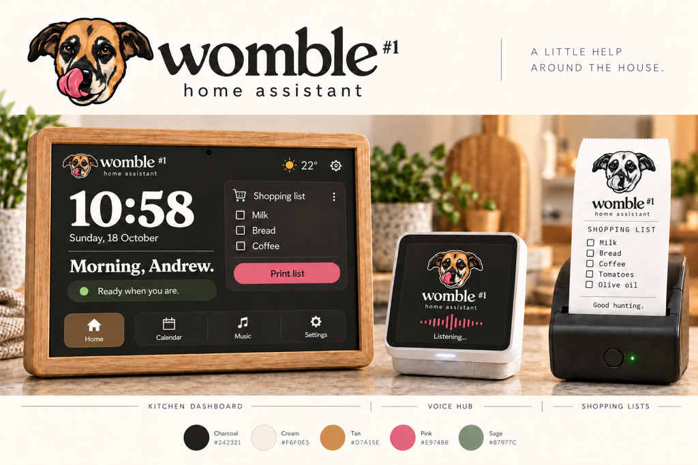

  

<h1 align="center">womble #1 · home assistant</h1>

<em>A little help around the house.</em>

A family of home devices: the ESP32-S3-BOX-3 voice hub, the re-flashed kitchen picture-frame dashboard and the Bluetooth shopping-list printer.

## Palette

| Token | Hex | Use |
|---|---|---|
| cream | `#F6F0E5` | Lettering on charcoal, light backgrounds |
| charcoal | `#242321` | Primary (dark theme preferred) background |
| surface | `#34312E` | Cards and raised surfaces on dark |
| tan | `#D7A15E` | Accent |
| pink | `#E97488` | Accent (tongue / highlight) |
| sage | `#87977C` | Secondary accent |

## Brand

The brand pack lives in [`docs/brand/`](docs/brand/), with the full guide at [`docs/brand/Womble-Brand-Guide.pdf`](docs/brand/Womble-Brand-Guide.pdf) and design tokens in [`docs/brand/implementation/tokens.json`](docs/brand/implementation/tokens.json).

- Wordmark: lowercase warm serif `womble` with a small raised #1 and `home assistant` centred beneath.
- Lockup: head left of the wordmark (horizontal) or above it (compact). Use cream lettering on charcoal; the dark theme is preferred.
- Listening state: the head tilts 15° clockwise.
- Receipts end with "Good hunting."
- Keep device status bars quiet: no large "Womble #1" text there.

  

## Docs

- [`DISPLAY.md`](DISPLAY.md): kitchen display layout plan
- [`docs/WOMBLE-SPEC.md`](docs/WOMBLE-SPEC.md): system spec
