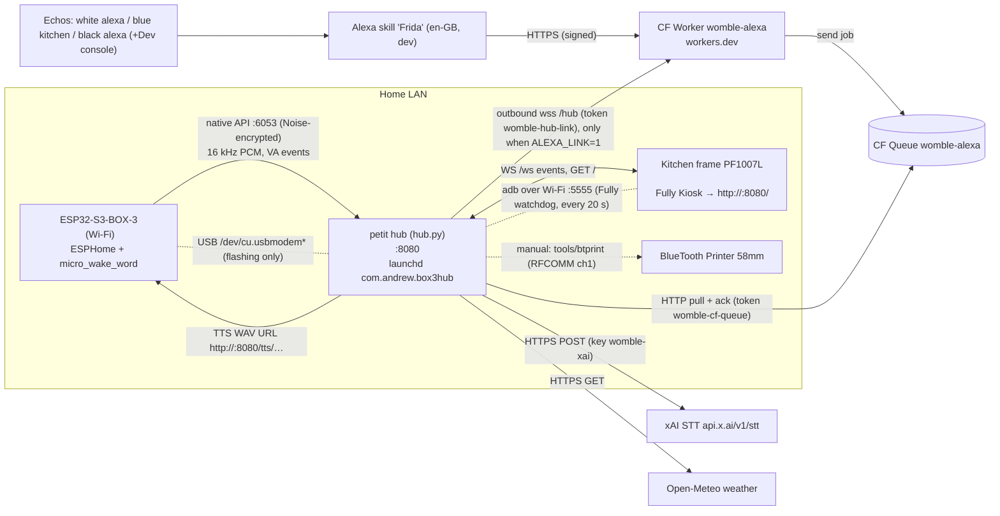
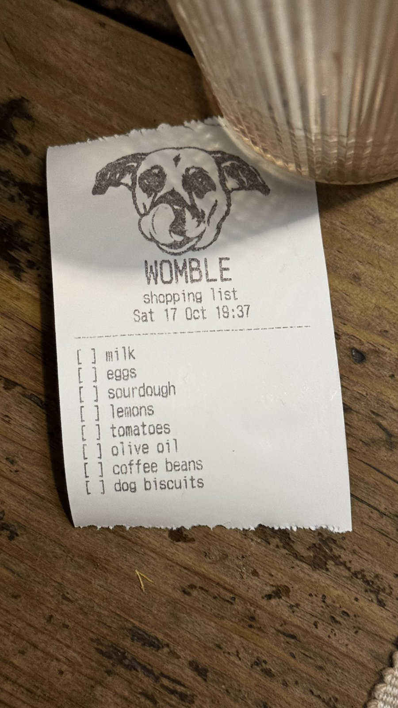

*Written 2026-10-17 from the real files on petit (*`/Users/decoy/box3-voice`*). I read the code but changed nothing. **\[unverified\]** marks anything I could not confirm from files or logs. Secrets are named here, never quoted.*

*Updated 2026-10-17 16:05 (Madrid) by Box Forge: repo, frame adb over Wi-Fi + Fully watchdog, power-cut recovery, recorder fixes and first recordings, printer slip format and list archive.*

## 0. Repo

* **GitHub:** [wttp3/womble](<https://github.com/wttp3/womble>), **private**, branch `main`. Created 2026-10-17; first commit `35237f0` (56 files).
* **Working copy:** `~/box3-voice` on petit is the clone (remote `origin`, ssh, via `gh` logged in as wttp3). Commit and push from there.
* **In the repo:** hub code and tests (`slice1/hub/`), BOX-3 ESPHome yaml + `models/womble.*`, `secrets.example.yaml`, the Alexa Worker (`alexa/`, source only), the frame watchdog (`frame/fully_watch.sh`), print tools (`tools/`, `hub/print/*.py`), the print header files, and the docs (`docs/WOMBLE-SPEC.md`, `DISPLAY.md`, READMEs).
* **Kept out by** `.gitignore`**:** `secrets.yaml`, `.env*`, `.dev.vars`; build and deps (`.esphome/`, `.venv/`, `node_modules/`, `.cloudflare/`, `.wrangler/`, `__pycache__/`); `*.log`, `devlog*.txt`, `*.bak*`; everything in `slice1/hub/data/` except `print_header.escpos`, `print_header_dog.png` and `live_stt_test.py` (so no voice clips, wake-word samples, TTS cache, lists or Echo device ids); `hub/print/*.bin`; `frame-boot*.png`.
* **Before committing:** check that no keys or passwords are in the diff. Never commit wake-word training clips; back those up somewhere private and separate.

## 1. Overview

Womble #1 is Andrew's home voice assistant. Voice comes in from a BOX-3 or from the Echos (through the Alexa skill "Frida"). The Python hub on the Mac mini **petit** handles it: speech-to-text, a rule router, JSON lists and spoken replies. The kitchen picture frame shows the hub's UI. A Bluetooth thermal printer prints slips. Today it only does lists; everything else is on the roadmap.

**Design rule:** nothing connects into the home network. There are no open ports and no tunnels. Alexa traffic reaches the hub because the hub pulls a Cloudflare Queue, or, when the live link is on, because the hub opens an outbound WebSocket to the worker.

### Data flows

1. **BOX-3 voice.** On-device micro_wake_word fires and calls `voice_assistant.start`. Audio streams over the ESPHome native API to `hub.py` (aioesphomeapi `subscribe_voice_assistant`). The adaptive energy VAD in `Session.feed` ends the utterance. `transcribe()` tries xAI STT and falls back to mlx-whisper. Then `route()` runs, `data/lists.json` is updated, the frame gets events (`voice.listening`, then `voice.heard`/`voice.cancel`, then `list.updated`/`reply`), and Kokoro TTS writes a WAV to `data/tts/`. The hub sends `TTS_END {url}` and the BOX-3 media player fetches and plays it. Timing is appended to `data/timing.jsonl`, post-wake audio is saved passively, and `data/last_utterance.wav` is overwritten.
2. **Alexa / Frida.** "Alexa, ask Frida to add milk" goes to the Worker. The Worker verifies the signature and cert chain, checks a ±150 s timestamp window and the applicationId. When `AlexaLink` is connected (`ALEXA_LINK=1`, heartbeat within 30 s) the Worker pushes the job down the hub's outbound socket and the Echo speaks the router or brain answer; the frame shows the same card. At 1.2 s it says "One moment…". At 6.5 s it says "That's taking a while. I'll put it on the kitchen frame." and still enqueues the job. If the hub socket is down, it enqueues and says "On it." The hub's `AlexaPuller` pulls the queue and drops duplicate requestIds (`data/alexa_seen.json`); the live link claims the id first so a cutoff job is not shown twice. Jobs older than 10 min are reported as "missed" and not run. The same words within 10 s from any Echo are skipped. The device is mapped to a room (`data/alexa_devices.json`), the frame gets `voice.heard` with a room chip, and the text goes through `route()` then the brain. A follow-up stays in session `alexa:<sessionId>`.
3. **Frame UI.** Fully Kiosk loads `GET /` (`static/display.html`) and opens `WS /ws`. The hub sends `snapshot` on connect, then events. The page sends `hello` and `tap` messages back. Local tools and tests can inject events with `POST /api/event`.
4. **Printing (manual only).** A slip is built as an ESC/POS byte file (latest: `slice1/hub/print/job.bin`) and sent with `~/box3-voice/tools/btprint "$PRINTER_MAC" <file> [channel]` (`PRINTER_MAC=<printer-mac>` in `local.env`) over IOBluetooth RFCOMM. Nothing in the hub prints by itself yet; an agent builds and sends the slip on request. Format in §2.7.

## 2. Components

### 2.1 Hub (`slice1/hub/`)

* **Purpose:** voice pipeline, router, lists, TTS, display server and Alexa puller, all in one asyncio process.
* **Files:**
  * `hub.py`: STT, router, TTS, `Session` VAD, BOX-3 reconnect loop, web app.
  * `stt_xai.py`
  * `alexa_pull.py`
  * `alexa_link.py`: outbound WebSocket to the worker. Off unless `ALEXA_LINK=1`.
  * `display.py`
  * `recorder.py`: wake-word sample recorder.
  * `smoke.py`, `replay_vad.py`, `test_session.py`: dev helpers.
  * `requirements.txt`: aioesphomeapi>=46,<47, mlx-whisper, mlx-audio, misaki\[en\], numpy, soundfile, aiohttp, requests (used by `stt_xai.py`).
  * `.venv/`: Python 3.12, created with uv.
  * Old `*.bak-*` copies sit next to the files they replaced. They are not used.
* **Startup chain:** launchd `~/Library/LaunchAgents/com.andrew.box3hub.plist` (RunAtLoad, KeepAlive, ThrottleInterval 10, WorkingDirectory `slice1`, stdout and stderr go to `slice1/hub.log`). That runs `hub/launch.sh` (zsh, sources the untracked `~/box3-voice/local.env` if present (home-network and Cloudflare values; template `local.env.example`), sets `PYTHONUNBUFFERED=1`, runs `caffeinate -i -s ./run.sh`). `run.sh` also sources `local.env`, exports `BOX3_NOISE_PSK` from the Keychain (`box3-api-key`/`hub`), plus `WHISPER_MODEL` (default `mlx-community/whisper-large-v3-turbo`) and `WHISPER_LANG` (default `en`), then runs `.venv/bin/python hub/hub.py`.
* **Env vars:**

| Var | Default | Meaning |
| -- | -- | -- |
| BOX3_HOST | (required, local.env) | BOX-3 address (`<box3-ip>`) |
| BOX3_NOISE_PSK | (required) | API encryption key, from Keychain |
| HUB_HOST_IP | (local.env; run.sh falls back to en0/en1) | IP the BOX-3 uses to fetch TTS (`<hub-ip>`) |
| HUB_PORT | 8080 | HTTP port |
| WHISPER_MODEL / WHISPER_LANG | turbo / en | local STT |
| STT_ENGINE | xai | `whisper` forces local STT |
| XAI_STT_TIMEOUT | 5 | seconds |
| TTS_ENGINE | kokoro | `say` forces macOS say |
| ALEXA_PULL | 1 | `0` disables the puller |
| ALEXA_LINK | 0 | `1` opens the outbound hub socket |
| ALEXA_WORKER_URL | unset | `wss://<worker-host>/hub` |
| ALEXA_LINK_TEST_DELAY_S | unset | delays each live answer; leave unset |
| ALEXA_POLL_S / ALEXA_IDLE_POLL_S / ALEXA_NIGHT_POLL_S | 2 / 5 / 15 | poll interval: active (message in the last 10 min) / idle / 23:00–07:00 |
| CF_ACCOUNT_ID, CF_QUEUE_ID | (required, local.env; no default) | CF account `<acct>` and queue `<queue-id>`. Old names ALEXA_CF_ACCOUNT / ALEXA_QUEUE_ID still work. If unset the puller logs an error and stays off. |
| ALEXA_KC_ACCOUNT | `decoy` | Keychain account |
| DISPLAY_NAME | Womble #1 |  |
| WEATHER_LAT / WEATHER_LON | 40.4168 / -3.7038 (Madrid) |  |
| DISPLAY_PRINTER | 0 | feature flag in the snapshot |
| DISPLAY_TOKEN | unset | bearer token for /api/event. Without it, only localhost may post. |
| WOMBLE_REC_POS | 50 | positive samples per speaker for the recorder |

* **STT (**`stt_xai.py`**,** `transcribe()` **in [hub.py](<http://hub.py>)):**
  * xAI `grok-voice-transcribe-2.0`, called as `POST https://api.x.ai/v1/stt`, multipart with `file=utt.wav` (16 kHz mono s16), `language=en` and `keyterm` × \[milk, bread, biscuits, eggs, Womble, Vic, Andrew, shopping, list, Frida\]. Bearer key from Keychain `womble-xai`/`decoy`, read once.
  * The model name appears only in the docstring; the request sends no model field.
  * Any exception or non-200 response falls back to mlx-whisper for that utterance. Whisper adds software gain when the peak is below 0.5.
  * Without the key, the hub logs "xai stt disabled" and uses whisper.
* **Router (**`route()`**, regex):**
  * `record … for andrew|vic*|victoria` → `record.start` (full session: positives + negatives).
  * `record other words|not womble|negatives for andrew|vic` → `record.start` with `only:"neg"` (just the 15 near-miss words). Added 2026-10-17.
  * `stop [recording]` while recording → `record.stop`.
  * `(please) add|put <item> [to|on (the|my) <list> (list)]` → `list.add`. The list defaults to `shopping`. Items are not split on "and".
  * `what's|show|read (on) (the|my) <list> list` → `list.show`.
  * Anything else → `fallback`, which says "Sorry, I can only do lists for now."
* **Lists file** `data/lists.json`**:** `{"<list>": [{"item": str, "ts": epoch_float}]}`. It is written in full on every add. There is no lock, and there is no remove/clear voice command.
* **Done-list archive** `data/lists_done.json`**:** `[{list, done_ts, items}]`. On 2026-10-17 the old shopping list (11 items) was archived here and cleared by hand at Andrew's request, so Frida could start a fresh list. After any hand edit, refresh the frame with `POST /api/event` `list.updated` (§5).
* **TTS:** mlx-audio Kokoro `prince-canuma/Kokoro-82M`, voice `af_heart`. Output is resampled to 48 kHz mono WAV with a 200 ms tail and saved as `data/tts/<uuid>.wav`. Nothing deletes these files **\[cleanup: none found\]**. If Kokoro fails, macOS `say` is used.
* **Warmup:** whisper and Kokoro load at startup. A cold Kokoro start takes about 30 s.
* **VAD constants:** onset at 3× the noise floor (minimum 60 RMS). End of speech is 0.65 s of silence relative to 15 % of the peak. Gives up after 5 s with no speech; maximum utterance 10 s.
* **BOX-3 link:** `APIClient(BOX3_HOST, 6053, noise_psk)` in an explicit reconnect loop (retries every 5 s). It mirrors device log lines that match WAKE/micro_wake/voice_assistant/\[W\]/\[E\] into hub.log under the `box3` logger.
* **HTTP (port 8080, 0.0.0.0):**
  * `GET /`: display.html
  * `GET /static/womble-mark.webp`, `/favicon.png`, `/favicon.ico`, `/apple-touch-icon.png`: the dog mark. Small WebP/PNG copies of the colour mark `docs/womble-dog-colour.png` (trimmed, transparent). The full-size original is not served.
  * `WS /ws`
  * `POST /api/event`
  * `GET /api/taps`
  * `GET /tts/<file>`
  * `GET /old`: the slice-1 page `slice1/display/index.html` (rollback)
* **Logs and data:**
  * `slice1/hub.log`: everything, including aiohttp access lines.
  * `data/timing.jsonl`: one JSON line per utterance with fields text, end_reason, speech_start_s/speech_end_s, peak, noise_floor, rms\_\*, category, audio_s, `{eos,stt,route,display,tts}_ms` (measured from wake), stt_only_ms, tts_only_ms.
  * `data/last_utterance.wav`.
* **Power cuts:** petit reboots on its own and launchd starts the hub and the Fully watchdog. The hub reconnects to the BOX-3 and the Alexa puller retries with backoff until the internet is back (checked 2026-10-17 after several cuts).
* **Restart:** `launchctl kickstart -k gui/$(id -u)/com.andrew.box3hub`. Check it with `tail -f ~/box3-voice/slice1/hub.log`. Look for "connected to BOX-3, voice assistant subscribed" and "alexa pull running".
* **Tests:** run each one directly from `slice1/hub/` with `.venv/bin/python tests/<file>.py` (no pytest):
  * `test_stt_xai.py`: mocked HTTP.
  * `test_alexa_pull.py`: offline, no Keychain.
  * `test_recorder.py`: fake device.
  * `fake_driver.py`: needs playwright + Chromium and takes display screenshots.
  * Also in `data/`: `live_stt_test.py` (live, uses the key) and `smoke.jsonl`.
* **Known issues:** TTS files pile up. (`lists.json` writes are atomic: temp file, fsync, `os.replace`.) The BOX-3 log shows "display took a long time" warnings (harmless). The Echo speaks a live answer only while the hub socket is up; otherwise it still says "On it." The worker's own model fallback is not built.
* **Boundary:** the hub owns the lists and the router. Home Assistant and announce-bridge work belong to other bots.

### 2.2 Display service and frame page (`slice1/hub/display.py`, `static/display.html`, spec `DISPLAY.md`)

* `display.py` is pure aiohttp with no ML imports. Run it standalone with `.venv/bin/python display.py --port 8099 [--lists file]`.
* **Envelope (hub → page):** `{"v":1,"event","id","corr","ts","ttl_s","priority","data"}`.
* **Events the code emits today:**
  * `snapshot` on connect, with data `device_name`, `features.printer`, `lists {name:[str]}`, `weather`, `media`, `recipe`, `step`, plus `record` counts from the recorder.
  * `voice.listening {wake_word, source:"box3-kitchen"}`
  * `voice.heard {text[, source:"alexa", room, device]}`
  * `voice.cancel {reason}`
  * `list.updated {list, action:"add"|"show", items, highlight:[]}`
  * `reply {title, body, short, source?}`. `short` is the first 60 words.
  * `toast {text, kind}`
  * `error {message, code}`
  * `weather {temp, code, max, min}`, every 15 min when it changes.
  * `idle`
  * The recorder's own UI events.
* **Defined in DISPLAY.md §6 but not emitted by any current producer:** recipe, recipe.step (taps only), media.state, research.added, home.done, print.status. Do not invent new types. Extend DISPLAY.md first.
* **Page → hub:** `{"event":"hello",...}` and `{"event":"tap","action":…}`. Actions are `dismiss`, `recipe.next|prev`, `media.toggle|next|prev` (which toasts "Music control isn't connected yet"), and `record.*`.
* `POST /api/event`**:** body `{"event","data","corr"?,"ttl_s"?,"priority"?}` or a legacy card `{type:"list"|"text",…}`. Accepted from localhost only unless `DISPLAY_TOKEN` is set. Returns `{"ok":true,"clients":n}`.
* **Device constraints** (from DISPLAY.md): WebView 106, 1280×800, one static file with vanilla JS, dark theme. Decisions are listed in DISPLAY.md §8. To refresh the frame, see §5 step 2.

### 2.3 Wake-word sample recorder (`slice1/hub/recorder.py`)

* **Active mode:** say "okay nabu, record Womble for Andrew/Vic". The hub presses the BOX-3 template button "Talk" to start pipelines with no wake word. It collects 50 positives in blocks (normal 15, quiet 10, across the room 10, walking away 10, faster 5) plus 15 negative (near-miss) phrases such as wobble, humble, tumble. The frame guides the session. Say "stop" or tap the frame to end.
* **Negatives only:** say "okay nabu, record other words for Andrew/Vic" (`start(..., only="neg")`; `plan()` filters the steps).
* **Audio bus fix (2026-10-17):** the BOX-3 mic and speaker share one I2S bus. If the beep plays while the mic still holds it, the speaker loops on "Parent bus is busy" and the next capture stalls. `_end_pipeline` is now async: it sends STT_VAD_END/STT_END, waits 0.6 s, then TTS_START/TTS_END (beep) and RUN_END. Backups: `recorder.py.bak-20261017-busfix`, `.bak-20261017-negonly`.
* **Files:**
  * `data/womble-samples/<speaker>/<ts>.wav`
  * `…/<speaker>/negatives/<ts>.wav`
  * `…/<speaker>/manifest.jsonl`
  * `data/womble-samples/_scrapped/`: clips moved aside rather than deleted.
  * Passive: `passive/<wake_word>/<ts>.wav` + `passive/manifest.jsonl`, one line per run: `{ts, wake_word, file, text, s}`.
  * None of this is in git (see §0).
* **Status (2026-10-17):**
  * Andrew: 51 positives (about 1.5 s each). A few have an empty "heard" field in the manifest (pos 8, 10, 14, 32, 36, 39, 43), and pos 9 heard a word list; check these at training time.
  * Andrew's first negatives picked up room noise while he was away, so they were moved to `_scrapped/andrew-negatives-20261017/`. `andrew/negatives/` is empty; he still needs to record them with the negatives-only command.
  * Vic: not recorded yet (full set + negatives).

### 2.4 BOX-3 firmware (`slice1/firmware/`)

* `box3-hub.yaml` is the active config. `box3-hub-nodisplay.yaml` is a variant without the LCD. Also present: `box3-hub.yaml.bak-202610151628` and `../backup/official-esp32-s3-box-3.yaml` (the official reference YAML; this is **not** a flash image).
* **Node:** name `grok-box3-dash`, friendly name "Kitchen BOX-3", board esp32s3box, `min_version` 2026.9.0. ESPHome CLI 2026.9.0 is installed via `uv tool`.
* **Network:** Wi-Fi with a static IP (`<box3-ip>`), set through `!secret box3_static_ip` / `box3_gateway` / `box3_subnet` / `box3_dns` in the untracked `secrets.yaml` (template `secrets.example.yaml`). The API is encrypted (`!secret api_key`) and OTA has a password (`!secret ota_password`).
* **Wake words** (`micro_wake_word`, id `mww`):
  * `okay_nabu`
  * custom `models/womble.json` + `womble.tflite`: microWakeWord v2, cutoff 0.89, author Andrew Webster
  * `hey_jarvis`

  hub.log shows only "Okay Nabu" detections so far. How well the Womble model works is **\[unverified\]**.
* **Other entities:** speaker `media_player` (`box_media`), `voice_assistant` (id `va`), a template text sensor "Voice status", buttons "Talk" (stop mww + start VA) and "Restart", the LCD ili9xxx S3BOX status display, and sntp.
* **LCD idle:** a white dog mark (109×78 grayscale, 8502 bytes of flash, from `docs/womble-dog.png`) above an amber WOMBLE wordmark, the clock and the hub line. Listening, thinking, speaking and error stay the coloured ring and label. Wi-Fi, API encryption, OTA, wake words and the partition layout are unchanged.
* **Secrets:** `secrets.yaml` holds wifi_ssid, wifi_password, api_key and ota_password. It is gitignored. Its template is `secrets.example.yaml`.
* **Logs** from earlier runs are in `slice1/`: compile-*.log, flash*.log, flash-usb\*.log. `flash-usb.log` reports chip ESP32-S3 (QFN56) rev v0.2.
* **No esptool** `read_flash` **backup image was found** under `~/box3-voice` (or `~` to depth 3). Make one before the next flash.
* **USB:** as of 2026-10-17 the BOX-3 is plugged into petit and shows as `/dev/cu.usbmodem2401` (ready for flashing). It still talks to the hub over Wi-Fi.

### 2.5 Alexa Worker (`alexa/`)

* **Files:**
  * `src/index.js`: entry. `/hub` is the Durable Object socket; every other path is the skill and always verifies the request.
  * `src/app.js`: `handle(request, env, verify)`.
  * `src/hub_link.js`: `HubLink` Durable Object (hibernating WebSocket).
  * `src/verify.js` + `roots.js`: cert URL, chain and signature checks. Unchanged.
  * `cloudflare.config.ts`: worker `womble-alexa`, compat date 2026-09-30, workersDev, observability **off** (spoken text is never logged), bindings `QUEUE` (queue womble-alexa), secrets `ALEXA_SKILL_ID` and `HUB_LINK_TOKEN`, and SQLite Durable Object export `HubLink` bound as `HUB_LINK`.
  * `skill/interaction-model.en-GB.json`
  * `test/test.mjs`
* **Endpoint:** `POST <worker-url>/` or `/alexa` (the workers.dev URL `cf deploy` prints). `GET` with `Upgrade: websocket` on `/hub` is the hub socket and requires bearer `HUB_LINK_TOKEN`. Any other method or path returns 404. A bad or unconfigured skill request returns 400 with an `x-reason` header (skill id not configured / signature / json / timestamp / application id). A bad hub token returns 401; a foreign `Origin` returns 403.
* **Interaction model** (invocation `frida`):
  * AddIntent, FindIntent, SaveIntent and RememberIntent each send text prefixed with their verb (add / find / save / remember).
  * CaptureIntent and QuestionIntent send the raw `AMAZON.SearchQuery` slot (the carrier word is not included).
  * Built-in intents: Help, Stop, Cancel, NavigateHome, Yes, No, Fallback.
* **Queue job:** `{v:1, text, deviceId, ts, requestId, intent, locale, source:"alexa", sessionId}`, sent with contentType json, on the offline path and on the 6.5 s cutoff. A fast live answer is not queued. If the send fails, Alexa says "Womble's not reachable, try again."
* **Queue settings** (from alexa/README): HTTP pull consumer, batch 10, visibility 60 s, max retries 3, retry delay 5 s.
* **Test:** `cd ~/box3-voice/alexa && export PATH=~/.local/node/bin:$PATH && node test/test.mjs`.
* **Deploy:** `cf deploy`. Node ≥ 22.18 is required.
* **Skill:** "Frida", en-GB, dev stage, skill id `<skill-id>` (kept only in the Worker secret `ALEXA_SKILL_ID` and the Alexa developer console).
  * `alexa/README` still says `ALEXA_SKILL_ID` is the placeholder `unset`.
  * `data/alexa_devices.json` has 4 devices seen since 2026-10-16, so the secret has evidently been set since then. That README line is stale.

### 2.6 Alexa puller (`slice1/hub/alexa_pull.py`)

* **API:** `POST https://api.cloudflare.com/client/v4/accounts/<acct>/queues/<queue-id>/messages/pull` with `{batch_size:10, visibility_timeout_ms:60000}`, then `/ack` with `{acks, retries:[{lease_id, delay_seconds:5}]}`.
* **Errors:** a 401 or 403 stops the puller until restart and toasts "Alexa link: token problem". A 429 or 5xx triggers exponential backoff from 2 to 60 s.
* **Enabled when** `ALEXA_PULL!=0` **and** the Keychain item `womble-cf-queue` exists. The existence check does not read the secret.
* **Check without revealing secrets:** `.venv/bin/python alexa_pull.py --status`.
* **Live link** (`alexa_link.py`): outbound WebSocket, enabled only when `ALEXA_LINK=1`. Token is Keychain `womble-hub-link` (account `$USER`) or `HUB_LINK_TOKEN`. It shares `Seen`, `Devices` and the recent-text map with the puller. Deploy and the console rebuild are in `alexa/README.md`.
* **Files:**
  * `data/alexa_devices.json`: `{deviceId: {room, name, first_seen}}`. It is re-read on every job, so hand edits apply without a restart. Unknown devices are added as "Echo N".
  * `data/alexa_seen.json`: the last 500 requestIds.
* **Current rooms:** Dev console, white alexa, blue kitchen, black alexa.

### 2.7 Printer tools (`tools/`, `slice1/hub/print/`, `data/print_header.*`)

* `tools/btprint <addr> <file> [ch]`**:**
  * Runs an SDP query and uses the first RFCOMM channel unless one is given. Use channel 1.
  * Writes 128-byte chunks 40 ms apart, then sends the status query `10 04 01` and prints the reply. The last log shows `rx 0x1616`.
  * Closes the connection when done.
  * Log: `tools/btprint.log`.
* `tools/btdisc <addr>`**:** reports whether the device is connected and closes that connection.
* `tools/btpower [0|1]`**:** gets or sets the Bluetooth controller power state through a private IOBluetooth API.
* `data/print_header.escpos`**:** the dog logo as an ESC/POS raster, `GS v 0` style. Bytes 4–5 are width in bytes and 6–7 are height; the raster follows from byte 8. Source image: `print_header_dog.png`.
* `hub/print/*.py` (one, orig, probe, status, send) are earlier experiments. **They all open** `/dev/cu.BlueToothPrinter`**, which is DO NOT USE: it jams the macOS kernel and needs a reboot.**
  * `send.py shopping` still shows how to build a shopping slip: header raster in 24-row bands, centred "WOMBLE" double-size, "shopping list", date, a rule, `[ ] item` lines, 4 feeds. To reuse it, write the bytes to a file and send it with `btprint` instead of the serial port.
* **Slip format (current, printed OK 2026-10-17):** `ESC @`, `ESC a 1`, then `data/print_header.escpos` (dog), then `\n`, `ESC ! 0x30` + "WOMBLE", `ESC ! 0x00` + "shopping list", the date (`%a %d %b %H:%M`), `ESC a 0`, a 32-dash rule, one `[ ] item` line per item, then `ESC d 8` for extra bottom feed so nothing is cut off. A good reply from btprint ends with status `0x16`.
* **Reference slip (sample list, printed 2026-10-17 19:37):**

  

* **Paper:** 58 mm, 384 dots. Bottom feed is fixed (`ESC d 8`). Darkness is not set yet; it looks fine for now.

### 2.8 Kitchen frame (device)

* PF1007L "AEEZO", Android 6.0.1 (MOB30R), WebView/Chrome 106, rooted, Fully Kiosk PLUS. Installed in the kitchen (2026-10-17). IP `<frame-ip>`, reserved in the router by MAC. Start URL `http://<hub-ip>:8080/`.
* **MAC:** the Wi-Fi chip has no fixed MAC and it can change on reboot (the current one is `<frame-wifi-mac>`; it has changed at least twice). The router reservation is tied to `<frame-wifi-mac>`; if the frame ever gets a different IP, update the reservation.
* **adb over Wi-Fi:** `<frame-ip>:5555`, made persistent with `persist.adb.tcp.port=5555`, so it survives reboots. The frame is also on a USB cable to petit (serial `<frame-adb-serial>`) as a backup way in.
* **adb binary:** `/Users/decoy/platform-tools/adb`. Always run it with `ADB_LIBUSB=1`. After a power cut the default macOS USB backend hung while the adb server was starting, which stopped the watchdog; the libusb backend fixed it.
* **Fully watchdog:** the vendor firmware blocks Fully's start-on-boot and re-enables the stock launcher on every boot, so Fully can't stay the home app on its own. launchd `com.andrew.fullywatch` runs `~/box3-voice/frame/fully_watch.sh`, which sources `FRAME_HOST` (and optional `FRAME_ADB_PORT`) from `local.env`, reconnects adb if needed and, every 20 s, starts `de.ozerov.fully/.MainActivity` whenever the focused window is the Android launcher (`nexuslauncher`). After a boot or a home press, Fully is back in front within about 20–25 s. Log: `frame/fully_watch.log`. Backups: `fully_watch.sh.bak-usb` (old USB version), `.bak-20261017-libusb`.
* **Related folders in** `~`**:** `frame-apks/`, `frame-backup/`, plus screenshots `frame-*.png`. Their contents were not inspected **\[unverified\]**.
* No Bluetooth stack, no GPS (from context, **\[unverified\]** by me).

## 3. Hardware & network inventory

| Item | Identity | Address / link |
| -- | -- | -- |
| petit (Mac mini M2 16 GB, user `decoy`) | hub host | `<hub-ip>` (en0/en1), port 8080 |
| ESP32-S3-BOX-3 | `grok-box3-dash`, ESP32-S3 QFN56 rev v0.2, in the kitchen | Wi-Fi `<box3-ip>`, API 6053. USB `/dev/cu.usbmodem2401` on petit for flashing |
| Kitchen frame PF1007L | AEEZO, Android 6.0.1 | `<frame-ip>` (router reservation), adb Wi-Fi :5555, USB adb backup |
| Thermal printer | "BlueTooth Printer" `<printer-mac>`, ESC/POS 58 mm/384 dots | BT Classic RFCOMM ch 1 from petit |
| Echos | white alexa, blue kitchen, black alexa (+ Dev console = simulator) | Amazon cloud → skill Frida |
| Cloudflare | account `<acct>`, Worker womble-alexa, Queue womble-alexa | outbound HTTPS only |
| Harman Kardon Omni 10 | parked | — |

## 4. Secrets inventory (names and locations only)

| Secret | Location | Used by |
| -- | -- | -- |
| `box3-api-key` (account `hub`) | macOS Keychain on petit | [run.sh](<http://run.sh>) → BOX3_NOISE_PSK |
| `womble-xai` (account `decoy`) | Keychain | stt_xai.py |
| `womble-cf-queue` (account `decoy`) | Keychain. CF API token with Account·Queues·Edit | alexa_pull.py |
| `ALEXA_SKILL_ID` | Cloudflare Worker secret | Worker |
| wifi_ssid, wifi_password, api_key, ota_password | `slice1/firmware/secrets.yaml` (gitignored) | ESPHome build |
| cf CLI login/account cache | `slice1/.cloudflare/`, cf CLI config | deploys |
| DISPLAY_TOKEN (optional, unset) | env | /api/event |

Never print, copy or commit these. To check a Keychain item without reading its value, use `security find-generic-password -s <name> -a <acct>` without `-w`.

## 5. Operations runbook

1. **Restart the hub:** `launchctl kickstart -k gui/$(id -u)/com.andrew.box3hub`, then `tail -f ~/box3-voice/slice1/hub.log`. Wait about 15 s for warmup.
2. **Refresh the frame:**
   * The page reconnects on its own every 2 s.
   * After a hand edit of lists, push it: `curl -X POST localhost:8080/api/event -d '{"event":"list.updated","data":{"list":"shopping","action":"show","items":[...],"highlight":[]}}'` (localhost only).
   * adb: `export ADB_LIBUSB=1; A=/Users/decoy/platform-tools/adb; $A connect <frame-ip>:5555`. Check focus with `$A -s <frame-ip>:5555 shell dumpsys window | grep mCurrentFocus`. Screenshot: `$A -s <frame-ip>:5555 exec-out screencap -p > ~/frame-now.png`.
   * If the frame sits on the Android home screen, check the watchdog: `launchctl list | grep fullywatch` and `frame/fully_watch.log`. If adb commands hang, kill all adb processes and let the watchdog restart the server (it sets `ADB_LIBUSB=1`).
3. **Reflash the BOX-3 safely** (ask Andrew first):
   1. Confirm the chip with `esptool chip_id`.
   2. Back up with `esptool --port /dev/cu.usbmodem* read_flash 0 0x1000000 ~/box3-voice/slice1/backup/box3-<date>.bin`. The 16 MB size is **\[unverified\]**.
   3. Build with `cd ~/box3-voice/slice1 && esphome compile firmware/box3-hub.yaml`.
   4. Flash OTA with `esphome run firmware/box3-hub.yaml --device <box3-ip>`, or over USB.
   5. Check that hub.log reconnects.

   Never erase flash or burn eFuses.
4. **Redeploy the Worker:** `cd ~/box3-voice/alexa && export PATH=~/.local/node/bin:$PATH && node test/test.mjs && cf deploy`. Secret changes go through `cf workers secrets update ALEXA_SKILL_ID --worker womble-alexa …`.
5. **Print a slip:** build an ESC/POS file in the §2.7 slip format, then run `~/box3-voice/tools/btprint "$PRINTER_MAC" /path/slip.bin 1`. Check that the output shows `sent N`, status `0x16` and `closed`.
6. **After a power cut:** nothing manual should be needed. Check `launchctl list | grep andrew` (box3hub + fullywatch), hub.log for "connected to BOX-3", and the frame focus (step 2).
7. **Recover the printer:**
   * If btprint says "not open": run `tools/btdisc "$PRINTER_MAC"`, power-cycle the printer, and retry. If that still fails, cycle Bluetooth with `tools/btpower 0; sleep 2; tools/btpower 1`.
   * If something opened `/dev/cu.BlueToothPrinter` and the system hangs, only a reboot of petit clears it. Ask Andrew.
8. **Alexa not arriving:**
   * Run `alexa_pull.py --status` and grep hub.log for `alexa`.
   * An `auth_error` means the token was rejected; the token needs replacing (Andrew types it in himself).
   * A 400 from the Worker means the skill id or signature is wrong.
9. **Force local STT:** add `export STT_ENGINE=whisper` to [run.sh](<http://run.sh>) (ask first) and restart.

## 6. Rules for agents

* Work **read-only** on Andrew's machines unless the task says otherwise. Ask before big changes or installs. No sudo.
* **Firmware:**
  * Confirm the chip id.
  * Take a `read_flash` backup and keep the image on petit before any flash.
  * Never erase flash or burn eFuses without Andrew's explicit yes.
  * Never touch the serial port of a device you weren't asked about.
* Never use `/dev/cu.BlueToothPrinter`. Print only through `tools/btprint`.
* Secrets live only in the Keychain, Worker secrets or untracked files. Never read, print or commit them.
* No inbound ports, tunnels or port forwards into the home network. Integrations pull.
* Don't invent display event types. Extend DISPLAY.md §6 first.
* Back up before editing: `file.bak-YYYYMMDD-tag` copies are still used locally (gitignored), and the code is in git (see §0). Commit and push working changes to wttp3/womble. Restart with launchctl and run the tests in `tests/`.
* Home Assistant and announce-bridge work belong to other bots (Bridge Plan, BOX-3 Sync). Here, HA is only ever an action target.

## 7. Roadmap / workstreams

 1. **Womble wake word.** A `womble.tflite` (v2) is already flashed alongside okay_nabu and hey_jarvis. Next steps:
    1. Recorder sessions: Andrew's 51 positives are done (2026-10-17). Still to do: Andrew's negatives ("record other words for Andrew"), and Vic's full set plus negatives. Removing hey_jarvis is still an open question.
    2. Train round 2 with microWakeWord (or openWakeWord).
    3. Measure false accepts and misses from the logs.
    4. Tune `probability_cutoff`.
    5. Then drop the stock models.
 2. **Grok voice realtime chat.** Wire `wss://api.x.ai/v1/realtime` into the `fallback` branch of `route()`, with tools list.add / [list.show](<http://list.show>) / record. Next: a design note on how audio gets back to the BOX-3 (WAV URL vs streaming), plus a latency budget.
 3. **"Print the shopping list" voice command.** Add a router intent and a `print.py` module that builds ESC/POS like `send.py` and shells out to `btprint`. Emit `print.status` (already defined in DISPLAY.md) and set `DISPLAY_PRINTER=1`.
 4. **Print quality.** Bottom feed done (`ESC d 8`, 2026-10-17). Darker density (ESC/POS heat settings `ESC 7` **\[printer support unverified\]**) is still open but low priority; print looks fine. Deferred until things are finalised.
 5. **List item splitting.** Split "X and Y" into separate items. Watch out for compounds like "fish and chips"; add tests.
 6. **List management.** Remove/clear/tick-off and a to-do list (DISPLAY.md §8 decision 3), (writes are already atomic).
 7. **Routing to Grok bots** for research, search and chat categories.
 8. **Music and media.** `display.media_handler` is the hook; the frame taps already exist.
 9. **Timers.** Chime on the BOX-3. Step mode is in DISPLAY.md.
10. **Home Assistant as an action target** (`home.done`). Coordinate with the bots that own the Bridge Plan.
11. **Harman Kardon Omni 10.** Parked.
12. **Housekeeping.**
    * Prune `data/tts/`.
    * Fix stale alexa/README text (skill id).
    * Make a BOX-3 flash backup (the board is now on USB at `/dev/cu.usbmodem2401`).
    * Check Cloudflare costs.
    * ~~Optionally set up git~~ Done 2026-10-17: private repo wttp3/womble (see §0).
