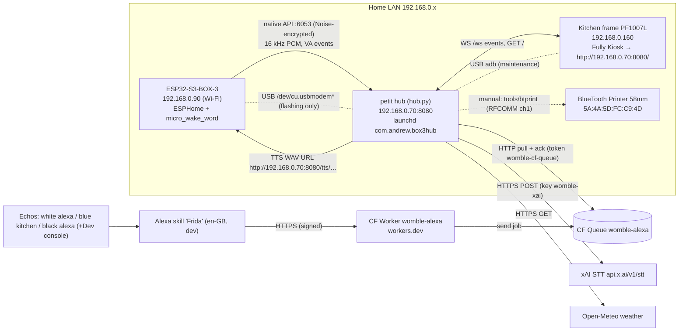

# Womble #1 — System spec & docs

_Written 2026-10-17 from the real files on petit (`/Users/decoy/box3-voice`). I read the code but changed nothing. **[unverified]** marks anything I could not confirm from files or logs. Secrets are named here, never quoted._

## 1. Overview

Womble #1 is Andrew's home voice assistant. Voice comes in from a BOX-3 or from the Echos (through the Alexa skill "Frida"). The Python hub on the Mac mini **petit** handles it: speech-to-text, a rule router, JSON lists and spoken replies. The kitchen picture frame shows the hub's UI. A Bluetooth thermal printer prints slips. Today it only does lists; everything else is on the roadmap.

**Design rule:** nothing connects into the home network. There are no open ports and no tunnels. Alexa traffic reaches the hub because the hub pulls it from a Cloudflare Queue.

### Data flows
1. **BOX-3 voice.** On-device micro_wake_word fires and calls `voice_assistant.start`. Audio streams over the ESPHome native API to `hub.py` (aioesphomeapi `subscribe_voice_assistant`). The adaptive energy VAD in `Session.feed` ends the utterance. `transcribe()` tries xAI STT and falls back to mlx-whisper. Then `route()` runs, `data/lists.json` is updated, the frame gets events (`voice.listening`, then `voice.heard`/`voice.cancel`, then `list.updated`/`reply`), and Kokoro TTS writes a WAV to `data/tts/`. The hub sends `TTS_END {url}` and the BOX-3 media player fetches and plays it. Timing is appended to `data/timing.jsonl`, post-wake audio is saved passively, and `data/last_utterance.wav` is overwritten.
2. **Alexa / Frida.** "Alexa, ask Frida to add milk" goes to the Worker. The Worker verifies the signature and cert chain, checks a ±150 s timestamp window and the applicationId, then calls `QUEUE.send(job)` and Alexa says "On it." The hub's `AlexaPuller` pulls the queue and drops duplicate requestIds (`data/alexa_seen.json`). Jobs older than 10 min are reported as "missed" and not run. The same words within 10 s from any Echo are skipped. The device is mapped to a room (`data/alexa_devices.json`), the frame gets `voice.heard` with a room chip, and the text goes through the same `route()`. The result is shown on the frame. **Nothing is spoken back through the Echo** except the Worker's "On it."
3. **Frame UI.** Fully Kiosk loads `GET /` (`static/display.html`) and opens `WS /ws`. The hub sends `snapshot` on connect, then events. The page sends `hello` and `tap` messages back. Local tools and tests can inject events with `POST /api/event`.
4. **Printing (manual only).** A slip is built as an ESC/POS byte file and sent with `~/box3-voice/tools/btprint 5A:4A:5D:FC:C9:4D <file> [channel]` over IOBluetooth RFCOMM. Nothing in the hub prints yet.

## 2. Components

### 2.1 Hub (`slice1/hub/`)
- **Purpose:** voice pipeline, router, lists, TTS, display server and Alexa puller, all in one asyncio process.
- **Files:**
  - `hub.py`: STT, router, TTS, `Session` VAD, BOX-3 reconnect loop, web app.
  - `stt_xai.py`
  - `alexa_pull.py`
  - `display.py`
  - `recorder.py`: wake-word sample recorder.
  - `smoke.py`, `replay_vad.py`, `test_session.py`: dev helpers.
  - `requirements.txt`: aioesphomeapi≥30, mlx-whisper, mlx-audio, misaki[en], numpy, soundfile, aiohttp. **Note:** `stt_xai.py` imports `requests`, which is not listed. It is presumably installed transitively **[unverified]**.
  - `.venv/`: Python 3.12, created with uv.
  - Old `*.bak-*` copies sit next to the files they replaced. They are not used.
- **Startup chain:** launchd `~/Library/LaunchAgents/com.andrew.box3hub.plist` (RunAtLoad, KeepAlive, ThrottleInterval 10, WorkingDirectory `slice1`, stdout and stderr go to `slice1/hub.log`). That runs `hub/launch.sh` (zsh, sets `HUB_HOST_IP=192.168.0.70` and `PYTHONUNBUFFERED=1`, runs `caffeinate -i -s ./run.sh`). `run.sh` exports `BOX3_NOISE_PSK` from the Keychain (`box3-api-key`/`hub`), plus `WHISPER_MODEL` (default `mlx-community/whisper-large-v3-turbo`) and `WHISPER_LANG` (default `en`), then runs `.venv/bin/python hub/hub.py`.
- **Env vars:**

| Var | Default | Meaning |
|---|---|---|
| BOX3_HOST | 192.168.0.90 | BOX-3 address |
| BOX3_NOISE_PSK | (required) | API encryption key, from Keychain |
| HUB_HOST_IP | (required) | IP the BOX-3 uses to fetch TTS |
| HUB_PORT | 8080 | HTTP port |
| WHISPER_MODEL / WHISPER_LANG | turbo / en | local STT |
| STT_ENGINE | xai | `whisper` forces local STT |
| XAI_STT_TIMEOUT | 5 | seconds |
| TTS_ENGINE | kokoro | `say` forces macOS say |
| ALEXA_PULL | 1 | `0` disables the puller |
| ALEXA_POLL_S / ALEXA_IDLE_POLL_S / ALEXA_NIGHT_POLL_S | 2 / 5 / 15 | poll interval: active (message in the last 10 min) / idle / 23:00–07:00 |
| ALEXA_CF_ACCOUNT, ALEXA_QUEUE_ID, ALEXA_KC_ACCOUNT | built in | CF account, queue df7fc532…, Keychain account `decoy` |
| DISPLAY_NAME | Womble #1 | |
| WEATHER_LAT / WEATHER_LON | 40.4168 / -3.7038 (Madrid) | |
| DISPLAY_PRINTER | 0 | feature flag in the snapshot |
| DISPLAY_TOKEN | unset | bearer token for /api/event. Without it, only localhost may post. |
| WOMBLE_REC_POS | 50 | positive samples per speaker for the recorder |

- **STT (`stt_xai.py`, `transcribe()` in hub.py):**
  - xAI `grok-voice-transcribe-2.0`, called as `POST https://api.x.ai/v1/stt`, multipart with `file=utt.wav` (16 kHz mono s16), `language=en` and `keyterm` × [milk, bread, biscuits, eggs, Womble, Vic, Andrew, shopping, list, Frida]. Bearer key from Keychain `womble-xai`/`decoy`, read once.
  - The model name appears only in the docstring; the request sends no model field.
  - Any exception or non-200 response falls back to mlx-whisper for that utterance. Whisper adds software gain when the peak is below 0.5.
  - Without the key, the hub logs "xai stt disabled" and uses whisper.
- **Router (`route()`, regex):**
  - `record … for andrew|vic*|victoria` → `record.start`.
  - `stop [recording]` while recording → `record.stop`.
  - `(please) add|put <item> [to|on (the|my) <list> (list)]` → `list.add`. The list defaults to `shopping`. Items are not split on "and".
  - `what's|show|read (on) (the|my) <list> list` → `list.show`.
  - Anything else → `fallback`, which says "Sorry, I can only do lists for now."
- **Lists file `data/lists.json`:** `{"<list>": [{"item": str, "ts": epoch_float}]}`. It is written in full on every add. There is no lock, and there is no remove/clear command.
- **TTS:** mlx-audio Kokoro `prince-canuma/Kokoro-82M`, voice `af_heart`. Output is resampled to 48 kHz mono WAV with a 200 ms tail and saved as `data/tts/<uuid>.wav`. Nothing deletes these files **[cleanup: none found]**. If Kokoro fails, macOS `say` is used.
- **Warmup:** whisper and Kokoro load at startup. A cold Kokoro start takes about 30 s.
- **VAD constants:** onset at 3× the noise floor (minimum 60 RMS). End of speech is 0.65 s of silence relative to 15 % of the peak. Gives up after 5 s with no speech; maximum utterance 10 s.
- **BOX-3 link:** `APIClient(BOX3_HOST, 6053, noise_psk)` in an explicit reconnect loop (retries every 5 s). It mirrors device log lines that match WAKE/micro_wake/voice_assistant/[W]/[E] into hub.log under the `box3` logger.
- **HTTP (port 8080, 0.0.0.0):**
  - `GET /`: display.html
  - `WS /ws`
  - `POST /api/event`
  - `GET /api/taps`
  - `GET /tts/<file>`
  - `GET /old`: the slice-1 page `slice1/display/index.html` (rollback)
- **Logs and data:**
  - `slice1/hub.log`: everything, including aiohttp access lines.
  - `data/timing.jsonl`: one JSON line per utterance with fields text, end_reason, speech_start_s/speech_end_s, peak, noise_floor, rms_*, category, audio_s, `{eos,stt,route,display,tts}_ms` (measured from wake), stt_only_ms, tts_only_ms.
  - `data/last_utterance.wav`.
- **Restart:** `launchctl kickstart -k gui/$(id -u)/com.andrew.box3hub`. Check it with `tail -f ~/box3-voice/slice1/hub.log`. Look for "connected to BOX-3, voice assistant subscribed" and "alexa pull running".
- **Tests:** run each one directly from `slice1/hub/` with `.venv/bin/python tests/<file>.py` (no pytest):
  - `test_stt_xai.py`: mocked HTTP.
  - `test_alexa_pull.py`: offline, no Keychain.
  - `test_recorder.py`: fake device.
  - `fake_driver.py`: needs playwright + Chromium and takes display screenshots.
  - Also in `data/`: `live_stt_test.py` (live, uses the key) and `smoke.jsonl`.
- **Known issues:** `requests` is not in requirements. TTS files pile up. `lists.json` writes are not atomic. The BOX-3 log shows "display took a long time" warnings (harmless). Any Echo reply other than "On it." would need the progressive response API **[not built]**.
- **Boundary:** the hub owns the lists and the router. Home Assistant and announce-bridge work belong to other bots.

### 2.2 Display service and frame page (`slice1/hub/display.py`, `static/display.html`, spec `DISPLAY.md`)
- `display.py` is pure aiohttp with no ML imports. Run it standalone with `.venv/bin/python display.py --port 8099 [--lists file]`.
- **Envelope (hub → page):** `{"v":1,"event","id","corr","ts","ttl_s","priority","data"}`.
- **Events the code emits today:**
  - `snapshot` on connect, with data `device_name`, `features.printer`, `lists {name:[str]}`, `weather`, `media`, `recipe`, `step`, plus `record` counts from the recorder.
  - `voice.listening {wake_word, source:"box3-kitchen"}`
  - `voice.heard {text[, source:"alexa", room, device]}`
  - `voice.cancel {reason}`
  - `list.updated {list, action:"add"|"show", items, highlight:[]}`
  - `reply {title, body, short, source?}`. `short` is the first 60 words.
  - `toast {text, kind}`
  - `error {message, code}`
  - `weather {temp, code, max, min}`, every 15 min when it changes.
  - `idle`
  - The recorder's own UI events.
- **Defined in DISPLAY.md §6 but not emitted by any current producer:** recipe, recipe.step (taps only), media.state, research.added, home.done, print.status. Do not invent new types. Extend DISPLAY.md first.
- **Page → hub:** `{"event":"hello",...}` and `{"event":"tap","action":…}`. Actions are `dismiss`, `recipe.next|prev`, `media.toggle|next|prev` (which toasts "Music control isn't connected yet"), and `record.*`.
- **`POST /api/event`:** body `{"event","data","corr"?,"ttl_s"?,"priority"?}` or a legacy card `{type:"list"|"text",…}`. Accepted from localhost only unless `DISPLAY_TOKEN` is set. Returns `{"ok":true,"clients":n}`.
- **Device constraints** (from DISPLAY.md): WebView 106, 1280×800, one static file with vanilla JS, dark theme. Decisions are listed in DISPLAY.md §8. To refresh the frame, see §5 step 2.

### 2.3 Wake-word sample recorder (`slice1/hub/recorder.py`)
- **Active mode:** say "record Womble for Andrew/Vic". The hub presses the BOX-3 template button "Talk" to start pipelines with no wake word. It collects 50 positives in blocks (normal 15, quiet 10, across the room 10, walking away 10, faster 5) plus a list of negative phrases. Say "stop" or tap to end.
- **Files:**
  - `data/womble-samples/<speaker>/<ts>.wav`
  - `…/<speaker>/negatives/<ts>.wav`
  - `…/<speaker>/manifest.jsonl`
  - Passive: `passive/<wake_word>/<ts>.wav` + `passive/manifest.jsonl`, one line per run: `{ts, wake_word, file, text, s}`.
- **Status today:** only `passive/` exists, so no Andrew or Vic recording session has been run yet.

### 2.4 BOX-3 firmware (`slice1/firmware/`)
- `box3-hub.yaml` is the active config. `box3-hub-nodisplay.yaml` is a variant without the LCD. Also present: `box3-hub.yaml.bak-202610151628` and `../backup/official-esp32-s3-box-3.yaml` (the official reference YAML; this is **not** a flash image).
- **Node:** name `grok-box3-dash`, friendly name "Kitchen BOX-3", board esp32s3box, `min_version` 2026.9.0. ESPHome CLI 2026.9.0 is installed via `uv tool`.
- **Network:** Wi-Fi with a static IP of 192.168.0.90. The API is encrypted (`!secret api_key`) and OTA has a password (`!secret ota_password`).
- **Wake words** (`micro_wake_word`, id `mww`):
  - `okay_nabu`
  - custom `models/womble.json` + `womble.tflite`: microWakeWord v2, cutoff 0.89, author Andrew Webster
  - `hey_jarvis`
  
  hub.log shows only "Okay Nabu" detections so far. How well the Womble model works is **[unverified]**.
- **Other entities:** speaker `media_player` (`box_media`), `voice_assistant` (id `va`), a template text sensor "Voice status", buttons "Talk" (stop mww + start VA) and "Restart", the LCD ili9xxx S3BOX status display, and sntp.
- **Secrets:** `secrets.yaml` holds wifi_ssid, wifi_password, api_key and ota_password. It is gitignored. Its template is `secrets.example.yaml`.
- **Logs** from earlier runs are in `slice1/`: compile-*.log, flash*.log, flash-usb*.log. `flash-usb.log` reports chip ESP32-S3 (QFN56) rev v0.2.
- **No esptool `read_flash` backup image was found** under `~/box3-voice` (or `~` to depth 3). Make one before the next flash.

### 2.5 Alexa Worker (`alexa/`)
- **Files:**
  - `src/index.js`: entry; always verifies the request.
  - `src/app.js`: `handle(request, env, verify)`.
  - `src/verify.js` + `roots.js`: cert URL, chain and signature checks.
  - `cloudflare.config.ts`: worker `womble-alexa`, compat date 2026-09-30, workersDev, observability **off** (spoken text is never logged), bindings `QUEUE` (queue womble-alexa) and secret `ALEXA_SKILL_ID`.
  - `skill/interaction-model.en-GB.json`
  - `test/test.mjs`
- **Endpoint:** `POST https://womble-alexa.andrew-ca2.workers.dev/` or `/alexa`. Any other method or path returns 404. A bad or unconfigured request returns 400 with an `x-reason` header (skill id not configured / signature / json / timestamp / application id).
- **Interaction model** (invocation `frida`):
  - AddIntent, FindIntent, SaveIntent and RememberIntent each send text prefixed with their verb (add / find / save / remember).
  - CaptureIntent sends the raw query.
  - All use the slot `query:AMAZON.SearchQuery`.
  - Built-in intents: Help, Stop, Cancel, NavigateHome, Fallback.
- **Queue job:** `{v:1, text, deviceId, ts, requestId, intent, locale, source:"alexa"}`, sent with contentType json. If the send fails, Alexa says "Womble's not reachable, try again."
- **Queue settings** (from alexa/README): HTTP pull consumer, batch 10, visibility 60 s, max retries 3, retry delay 5 s.
- **Test:** `cd ~/box3-voice/alexa && export PATH=~/.local/node/bin:$PATH && node test/test.mjs`.
- **Deploy:** `cf deploy`. Node ≥ 22.18 is required.
- **Skill:** "Frida", en-GB, dev stage, skill id `amzn1.ask.skill.b5fde062-3f52-4178-821c-bfae9f754985`.
  - `alexa/README` still says `ALEXA_SKILL_ID` is the placeholder `unset`.
  - `data/alexa_devices.json` has 4 devices seen since 2026-10-16, so the secret has evidently been set since then. That README line is stale.

### 2.6 Alexa puller (`slice1/hub/alexa_pull.py`)
- **API:** `POST https://api.cloudflare.com/client/v4/accounts/<acct>/queues/df7fc532644e4b1493fd5c4510718f54/messages/pull` with `{batch_size:10, visibility_timeout_ms:60000}`, then `/ack` with `{acks, retries:[{lease_id, delay_seconds:5}]}`.
- **Errors:** a 401 or 403 stops the puller until restart and toasts "Alexa link: token problem". A 429 or 5xx triggers exponential backoff from 2 to 60 s.
- **Enabled when** `ALEXA_PULL!=0` **and** the Keychain item `womble-cf-queue` exists. The existence check does not read the secret.
- **Check without revealing secrets:** `.venv/bin/python alexa_pull.py --status`.
- **Files:**
  - `data/alexa_devices.json`: `{deviceId: {room, name, first_seen}}`. It is re-read on every job, so hand edits apply without a restart. Unknown devices are added as "Echo N".
  - `data/alexa_seen.json`: the last 500 requestIds.
- **Current rooms:** Dev console, white alexa, blue kitchen, black alexa.

### 2.7 Printer tools (`tools/`, `slice1/hub/print/`, `data/print_header.*`)
- **`tools/btprint <addr> <file> [ch]`:**
  - Runs an SDP query and uses the first RFCOMM channel unless one is given. Use channel 1.
  - Writes 128-byte chunks 40 ms apart, then sends the status query `10 04 01` and prints the reply. The last log shows `rx 0x1616`.
  - Closes the connection when done.
  - Log: `tools/btprint.log`.
- **`tools/btdisc <addr>`:** reports whether the device is connected and closes that connection.
- **`tools/btpower [0|1]`:** gets or sets the Bluetooth controller power state through a private IOBluetooth API.
- **`data/print_header.escpos`:** the dog logo as an ESC/POS raster, `GS v 0` style. Bytes 4–5 are width in bytes and 6–7 are height; the raster follows from byte 8. Source image: `print_header_dog.png`.
- **`hub/print/*.py`** (one, orig, probe, status, send) are earlier experiments. **They all open `/dev/cu.BlueToothPrinter`, which is DO NOT USE: it jams the macOS kernel and needs a reboot.**
  - `send.py shopping` still shows how to build a shopping slip: header raster in 24-row bands, centred "WOMBLE" double-size, "shopping list", date, a rule, `[ ] item` lines, 4 feeds. To reuse it, write the bytes to a file and send it with `btprint` instead of the serial port.
- **Paper:** 58 mm, 384 dots. Darkness and bottom feed are not set yet (roadmap).

### 2.8 Kitchen frame (device)
- PF1007L "AEEZO", Android 6.0.1 (MOB30R), WebView/Chrome 106, rooted, Fully Kiosk PLUS. Fixed IP 192.168.0.160 (confirmed by hub access logs). Start URL `http://192.168.0.70:8080/`.
- **adb:** `~/platform-tools/adb` over USB from petit.
- **Related folders in `~`:** `frame-apks/`, `frame-backup/`, plus screenshots `frame-*.png`. Their contents were not inspected **[unverified]**.
- No Bluetooth stack, no GPS (from context, **[unverified]** by me).

## 3. Hardware & network inventory
| Item | Identity | Address / link |
|---|---|---|
| petit (Mac mini M2 16 GB, user `decoy`) | hub host | 192.168.0.70 (en0/en1), port 8080 |
| ESP32-S3-BOX-3 | `grok-box3-dash`, ESP32-S3 QFN56 rev v0.2 | Wi-Fi 192.168.0.90, API 6053. USB `/dev/cu.usbmodem*` for flashing |
| Kitchen frame PF1007L | AEEZO, Android 6.0.1 | 192.168.0.160, USB adb |
| Thermal printer | "BlueTooth Printer" 5A:4A:5D:FC:C9:4D, ESC/POS 58 mm/384 dots | BT Classic RFCOMM ch 1 from petit |
| Echos | white alexa, blue kitchen, black alexa (+ Dev console = simulator) | Amazon cloud → skill Frida |
| Cloudflare | account id ends …c926, Worker womble-alexa, Queue womble-alexa | outbound HTTPS only |
| Harman Kardon Omni 10 | parked | — |

## 4. Secrets inventory (names and locations only)
| Secret | Location | Used by |
|---|---|---|
| `box3-api-key` (account `hub`) | macOS Keychain on petit | run.sh → BOX3_NOISE_PSK |
| `womble-xai` (account `decoy`) | Keychain | stt_xai.py |
| `womble-cf-queue` (account `decoy`) | Keychain. CF API token with Account·Queues·Edit | alexa_pull.py |
| `ALEXA_SKILL_ID` | Cloudflare Worker secret | Worker |
| wifi_ssid, wifi_password, api_key, ota_password | `slice1/firmware/secrets.yaml` (gitignored) | ESPHome build |
| cf CLI login/account cache | `slice1/.cloudflare/`, cf CLI config | deploys |
| DISPLAY_TOKEN (optional, unset) | env | /api/event |

Never print, copy or commit these. To check a Keychain item without reading its value, use `security find-generic-password -s <name> -a <acct>` without `-w`.

## 5. Operations runbook
1. **Restart the hub:** `launchctl kickstart -k gui/$(id -u)/com.andrew.box3hub`, then `tail -f ~/box3-voice/slice1/hub.log`. Wait about 15 s for warmup.
2. **Refresh the frame:**
   - Reconnects on its own every 2 s.
   - To force a reload, run `~/platform-tools/adb shell am start -a android.intent.action.VIEW -d http://192.168.0.70:8080/ de.ozerov.fully` **[command unverified]**, or use the reload in Fully's own menu.
   - Screenshot: `adb exec-out screencap -p > ~/frame-now.png`.
3. **Reflash the BOX-3 safely** (ask Andrew first):
   1. Confirm the chip with `esptool chip_id`.
   2. Back up with `esptool --port /dev/cu.usbmodem* read_flash 0 0x1000000 ~/box3-voice/slice1/backup/box3-<date>.bin`. The 16 MB size is **[unverified]**.
   3. Build with `cd ~/box3-voice/slice1 && esphome compile firmware/box3-hub.yaml`.
   4. Flash OTA with `esphome run firmware/box3-hub.yaml --device 192.168.0.90`, or over USB.
   5. Check that hub.log reconnects.
   
   Never erase flash or burn eFuses.
4. **Redeploy the Worker:** `cd ~/box3-voice/alexa && export PATH=~/.local/node/bin:$PATH && node test/test.mjs && cf deploy`. Secret changes go through `cf workers secrets update ALEXA_SKILL_ID --worker womble-alexa …`.
5. **Print a slip:** build an ESC/POS file (e.g. `ESC @` … text … `ESC d n`), then run `~/box3-voice/tools/btprint 5A:4A:5D:FC:C9:4D /path/slip.bin 1`. Check that the output shows `sent N` and `closed`.
6. **Recover the printer:**
   - If btprint says "not open": run `tools/btdisc 5A:4A:5D:FC:C9:4D`, power-cycle the printer, and retry. If that still fails, cycle Bluetooth with `tools/btpower 0; sleep 2; tools/btpower 1`.
   - If something opened `/dev/cu.BlueToothPrinter` and the system hangs, only a reboot of petit clears it. Ask Andrew.
7. **Alexa not arriving:**
   - Run `alexa_pull.py --status` and grep hub.log for `alexa`.
   - An `auth_error` means the token was rejected; the token needs replacing (Andrew types it in himself).
   - A 400 from the Worker means the skill id or signature is wrong.
8. **Force local STT:** add `export STT_ENGINE=whisper` to run.sh (ask first) and restart.

## 6. Rules for agents
- Work **read-only** on Andrew's machines unless the task says otherwise. Ask before big changes or installs. No sudo.
- **Firmware:**
  - Confirm the chip id.
  - Take a `read_flash` backup and keep the image on petit before any flash.
  - Never erase flash or burn eFuses without Andrew's explicit yes.
  - Never touch the serial port of a device you weren't asked about.
- Never use `/dev/cu.BlueToothPrinter`. Print only through `tools/btprint`.
- Secrets live only in the Keychain, Worker secrets or untracked files. Never read, print or commit them.
- No inbound ports, tunnels or port forwards into the home network. Integrations pull.
- Don't invent display event types. Extend DISPLAY.md §6 first.
- Back up before editing: the repo already uses `file.bak-YYYYMMDD-tag` copies, and there is no git. Restart with launchctl and run the tests in `tests/`.
- Home Assistant and announce-bridge work belong to other bots (Bridge Plan, BOX-3 Sync). Here, HA is only ever an action target.

## 7. Roadmap / workstreams
1. **Womble wake word.** A `womble.tflite` (v2) is already flashed alongside okay_nabu and hey_jarvis. Next steps:
   1. Run recorder sessions for Andrew and Vic ("record Womble for Andrew").
   2. Train round 2 with microWakeWord (or openWakeWord).
   3. Measure false accepts and misses from the logs.
   4. Tune `probability_cutoff`.
   5. Then drop the stock models.
2. **Grok voice realtime chat.** Wire `wss://api.x.ai/v1/realtime` into the `fallback` branch of `route()`, with tools list.add / list.show / record. Next: a design note on how audio gets back to the BOX-3 (WAV URL vs streaming), plus a latency budget.
3. **"Print the shopping list" voice command.** Add a router intent and a `print.py` module that builds ESC/POS like `send.py` and shells out to `btprint`. Emit `print.status` (already defined in DISPLAY.md) and set `DISPLAY_PRINTER=1`.
4. **Print quality.** Darker density (ESC/POS heat settings `ESC 7` **[printer support unverified]**) and more bottom feed.
5. **List item splitting.** Split "X and Y" into separate items. Watch out for compounds like "fish and chips"; add tests.
6. **List management.** Remove/clear/tick-off and a to-do list (DISPLAY.md §8 decision 3), plus atomic writes.
7. **Routing to Grok bots** for research, search and chat categories.
8. **Music and media.** `display.media_handler` is the hook; the frame taps already exist.
9. **Timers.** Chime on the BOX-3. Step mode is in DISPLAY.md.
10. **Home Assistant as an action target** (`home.done`). Coordinate with the bots that own the Bridge Plan.
11. **Harman Kardon Omni 10.** Parked.
12. **Housekeeping.**
    - Add `requests` to requirements.
    - Prune `data/tts/`.
    - Fix stale alexa/README text (skill id).
    - Make a BOX-3 flash backup.
    - Optionally set up git (check with Andrew).
